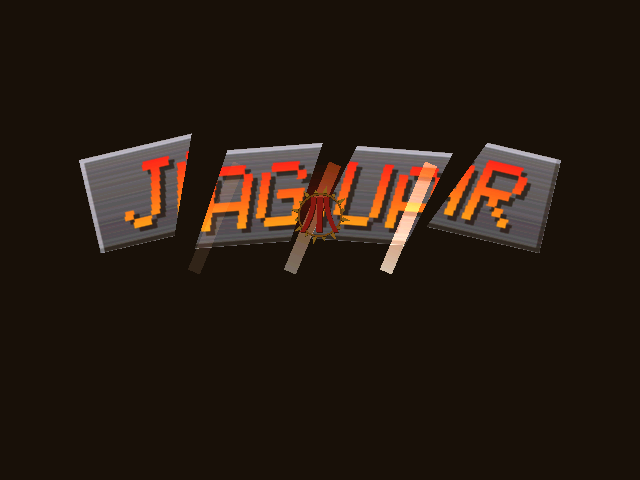
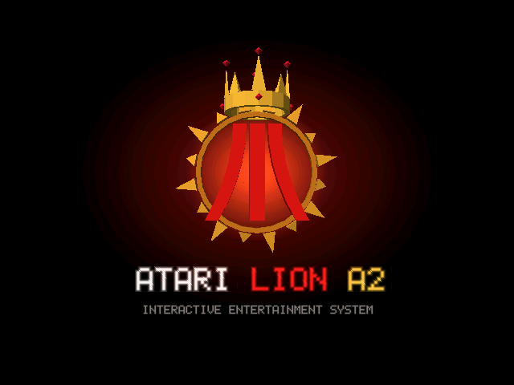
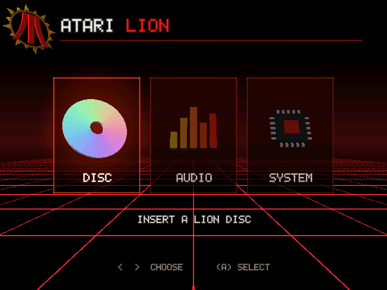
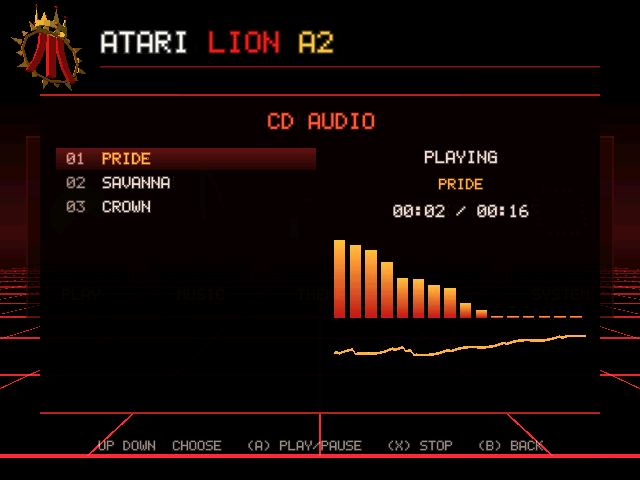

# Atari Lion A2 — emulador

Emulador de baixo nível do console fictício **Atari Lion A2 (Project Apex, 1999)**.
Especificação: [Atari-Lion-A2-Project-Apex.md](Atari-Lion-A2-Project-Apex.md) •
Referência de hardware do emulador: [docs/hardware.md](docs/hardware.md).

| Chip    | Emulação                                                              |
| ------- | --------------------------------------------------------------------- |
| Tuffy   | PowerPC 7400 @ 500 MHz: inteiros, FPU, AltiVec completo, MMU (BAT + tabela de páginas), caches L1/L2, despacho duplo, previsão de desvio |
| Quacker | MC88110 @ 100 MHz: delay slots, registradores x0–x31, SFU1 e SFU2 conforme o manual, caches, despacho duplo, TIC |
| QVE     | Quacker Vector Engine: transformação, projeção e iluminação de vetores |
| Spike   | Rasterizador: Z24, Gouraud, textura com perspectiva, bilinear, mipmap e trilinear |
| Tyke    | DSP de 40 MHz com conjunto de instruções próprio; firmware de mixagem de 24 canais |
| CD-ROM  | Drive 12× com busca, DMA e interrupção                                |
| Boot ROM | Código PowerPC: intro, dashboard 3D com player de CD, temas sonoros, ajustes do Tyke e visualizadores, boot de `BOOT.LION` |
| Barramento | Disputa pela SDRAM entre Tuffy, Quacker, DMA do CD e Tyke          |
| VI/PIC/Controles | 240p/480i/480p, interrupções, 4 portas analógico + digital   |

 
 

## Dashboard

Ao ligar, o console toca a intro:
1. o leão ruge;
2. três garradas rasgam uma placa "JAGUAR";
3. surge o emblema do Lion A2, e uma coroa cai sobre a juba.

Depois abre o dashboard, no estilo dos consoles de sexta geração com a cara do Lion: grade
vermelha rolando até o horizonte e cinco cards 3D.

- **PLAY:** dá boot no jogo do disco.
- **MUSIC:** player de CD para faixas `.WAV` do disco, com espectro e osciloscópio.
- **THEME:** escolhe o tema sonoro do dashboard. Os dois primeiros, LION A2 THEME (o padrão) e
  LION A2 THEME II, são as músicas de `Assets/`. Os outros são sequenciados pela ROM: PRIDE,
  NEON SAVANNA e NIGHT PLAINS. Há também SILENCE.
- **TYKE:** volume, graves, agudos e eco do DSP de áudio, com os medidores das 24 vozes e os
  visualizadores.
- **SYSTEM:** informações do hardware.

Tudo roda na própria Boot ROM, em PowerPC, desenhando pela Spike e tocando pelo Tyke.

Controles e opções:
- ← → escolhem, ↑ ↓ navegam nos painéis, A (tecla Z) ou Enter confirmam, B (tecla X) volta;
- X (tecla A) para a música;
- arraste um ISO para a janela para inserir o disco; F9 ejeta;
- `--fast-boot` simula uma unidade de desenvolvimento: sem intro, o disco dá boot na hora.

O rugido, as garras e os dois temas gravados vêm de `Assets/`. Depois de trocar esses arquivos,
gere de novo a versão que vai para a ROM (requer ffmpeg):

```bash
cmake --build build --target lionasset
```

```bash
tools/convert_assets.sh
```

Para montar um disco de música:

```bash
./build/mkdemo --music build/musica.iso faixa1.wav faixa2.wav
```

Sem arquivos, o comando grava três faixas de demonstração. Os `.wav` precisam ser PCM de
16 bits, mono ou estéreo, de 8 a 48 kHz.

Detalhes em [docs/hardware.md](docs/hardware.md#boot-rom-e-dashboard).

## Compilar

Requisitos: CMake ≥ 3.20, compilador C++23 (GCC 14 ou Clang 17+), SDL2.

```bash
cmake -S . -B build -G Ninja -DCMAKE_BUILD_TYPE=Release
```

```bash
cmake --build build
```

## Rodar a demo

`mkdemo` monta a demo "Apex Cube" (Tuffy → Quacker/QVE → Spike). Como disco ISO, ela
carrega uma textura com mipmaps do CD e desenha o cubo texturizado:

```bash
./build/mkdemo build/apex_cube.iso
```

```bash
./build/lion build/apex_cube.iso
```

Com a extensão `.lion`, `mkdemo` gera uma imagem sem disco, e o cubo sai só com Gouraud.

Na demo, ← e → mudam a velocidade de rotação e Z (botão A) para o cubo.

Opções úteis:

- `--headless --frames N`: roda sem janela e mostra estatísticas
- `--dump frame.ppm`: salva o último frame (implica `--headless`)
- o `lion` aceita imagens `.lion` e discos ISO9660; sem argumento, liga o console no dashboard
- `--fast-boot`: pula a intro (unidade de desenvolvimento)
- `--strict-7400`: `fsqrt`/`fsqrts` viram instruções ilegais, como no 7400 comercial
- `--trace-tuffy`, `--trace-quacker`: rastreia cada instrução
- `--verbose`, `--scale N`

Teclado (porta 1): setas, Z/X/C = A/B/C, A/S/D = X/Y/Z, Q/W = L/R,
Enter = Start, Shift direito = Select. Controles USB ocupam as portas 1–4.

## Testes

```bash
./build/lion_tests
```

## Organização

```
src/            núcleo (biblioteca lioncore) e frontend SDL2 (main.cpp)
  tuffy/        CPU PowerPC 7400 (inteiros, FPU, AltiVec, MMU, temporização)
  quacker/      CPU MC88110, controle/Command FIFO e QVE
  cdrom.*       drive de CD-ROM e leitura de ISO9660
  cache.h       modelo de cache usado pelas duas CPUs
  spike/        processador de comandos e rasterizador
  tyke/         DSP Tyke e firmware de mixagem
  bootrom.cpp   Boot ROM: intro, dashboard e loader (montados em código PowerPC)
  rom/          intro, dashboard, player de CD e visualizadores (PowerPC gerado em C++),
                e os dados: fonte, textura, malhas 3D, samples, jingle, temas, animações
  dispatch.h    modelo de despacho duplo e previsão de desvio
tools/          montadores PPC/88k/Tyke, gravador de ISO9660, demo, discos de música, mkdemo,
                conversor de áudio para a ROM (lionasset, convert_assets.sh, IMA ADPCM)
Assets/         áudio original (intro e temas) e Assets/rom/, a versão convertida para a ROM
tests/          testes unitários e de sistema
docs/           referência de hardware
```

## Observações

- A SFU2 do Quacker segue o *MC88110 User's Manual* (Motorola, 1991). Para `pmul`, o manual
  descreve os operandos de jeito diferente na seção 5 e na seção 10; o emulador segue a seção 5.
- O modelo de ciclos é aproximado: despacho duplo em ordem, sem modelar renomeação, execução
  fora de ordem nem filas de reserva.
- Na disputa pelo barramento, cada mestre usa o próprio relógio; como o escalonador os executa
  em fatias de 1 µs, a ordem entre mestres dentro de uma fatia é aproximada.

## Unreal no Lion

O **motor do Unreal 1** do repositório [RedPandaProjects/UnrealEngine](https://github.com/RedPandaProjects/UnrealEngine)
é compilado com clang para o Tuffy e roda dentro do emulador: Core (objetos, nomes, pacotes), Engine (níveis,
atores, física, `UGameEngine`), a máquina virtual do UnrealScript (as classes de `Engine.u` e `UNreal.u` rodam de
verdade) e o renderizador do BSP (pacote Render). Um pacote novo, `LionDrv`, faz o papel do `WinDrv`/`SoftDrv`/
`Galaxy`: o cliente e o viewport, o dispositivo de render (`ULionRenderDevice`), que desenha pela Spike com
Z-buffer, mipmaps, color key e **lightmaps** (cada polígono é cortado em triângulos de poucos texels e cada canto
amostra o lightmap que o Render calcula), a entrada pelo controle e o **áudio no Tyke** (`ULionAudioSubsystem`).

Como o repositório não traz mapas (só o `Entry.unr`, uma sala cúbica), a **fase é construída no próprio console** na
inicialização, com o código de edição do Unreal compilado para o Tuffy (CSG, construtor de BSP, visibilidade e
iluminação de `Editor/`): `editor/LionMap.cpp` escava sete salas e corredores de um mundo sólido com caixas, textura
as paredes com texturas procedurais (o repositório não tem texturas de parede), põe luzes estáticas, calcula as
sombras por raios e povoa o mapa com monstros e itens do `UNreal.u`.

Estado: o jogo `UNreal.SinglePlayer` carrega do CD em cerca de 20 s de tempo emulado, o jogador `MaleOne` nasce no mapa
com o HUD e as armas do Unreal, e o jogo roda a 60 Hz com colisão, luz, som, combate com os monstros e entrada
pelo controle. A tela mostra uma barra de carregamento vermelha enquanto o jogo é lido do CD. O jogo não está
completo: são sete salas e não as fases originais (que não estão no repositório), sem música e sem as sequências do
jogo original.

Áudio: o firmware de mixagem do Tyke (24 vozes PCM16) toca os sons. Os sons ficam no CD (11 MB no `UNreal.u`): o
motor só registra onde cada onda está no arquivo, e a primeira vez que um som toca ele é lido do CD, convertido para
PCM16 mono e guardado num cache de 1 MB. Há atenuação por distância, pan estéreo e sons ambiente em loop.

Tempo de carga: cada leitura do CD custa uns 100 ms de busca, e carregar o `UNreal.u` fazia mais de mil leituras
espalhadas (cerca de 2 minutos). O `build.sh` agora roda o jogo uma vez no emulador (headless) para gravar quais blocos
de 4 KB do disco o jogo toca e em que ordem (`g_cd_trace`, em `lionrt.cpp`), e o `unrport --preload` grava esses
blocos em sequência no disco (`PRELOAD.BIN`, nomeados em `PRELOAD.MAP`): a carga passa a ler o disco em corridas de
128 KB. Os blocos que a gravação leu várias vezes ficam fixos na RAM (cerca de 1,4 MB). O rastro fica em
`build/<disco>.trace`; `UNRPORT_RETRACE=1` regrava.

Memória e tempo: o heap tem 22 MB dos 24 MB (o jogo usa cerca de 19 MB); o `Engine.u` e o `Editor.u` vêm do CD, que tem
um cache de blocos compartilhado. Quando o heap aperta, o jogo coleta lixo e esvazia o cache de áudio. O relógio do
jogo é o contador de quadros do vídeo: cada tick avança o mundo pelos quadros de 60 Hz que passaram (de 1 a 6) e
espera o próximo vblank quando termina cedo.

Como funciona (`tools/unrport/`):
- `core/build_core.sh` e `engine/build_engine.sh` copiam Core e Engine do checkout e aplicam `patch_core.py` /
  `patch_engine.py` (MSVC antigo → clang, big-endian, sem as rotinas x86) e `core/hoist_for.py` (escopo de
  variável de `for`). O checkout nunca é modificado e nenhum código da Epic entra neste repositório. A
  compilação usa o layout do MSVC (`-mms-bitfields -fpack-struct=4`), senão as classes do motor não batem com os
  tamanhos do UnrealScript;
- `core/lionrt.cpp`: libc mínima, heap, arquivos do RAM disc, ABI de exceções (um `throw` trava);
- `core/lionplat.cpp`: substitui o `UnPlat.cpp` do Windows (log, config por `.ini`, tabela de classes nativas);
- `engine/lionboot.cpp`: o `InitEngine()`/`MainLoop()` do Windows; `liondrv/`: o pacote LionDrv (render, entrada, áudio);
- `editor/`: `patch_editor.py` e a cola mínima do `UEditorEngine` (`LionEditor.cpp`) para compilar o CSG/BSP/iluminação
  do Editor, e o construtor de mapa (`LionMap.cpp`);
- `unrport.cpp` (no host) empacota o disco: o mapa, `Core.u`, `Engine.u`, `Lion.ini` e as localizações.

```bash
cmake --build build --target unrport
```

```bash
UNREAL_SRC=/caminho/para/UnrealEngine tools/unrport/build.sh $UNREAL_SRC/Engine/Maps/Entry.unr build/unreal.iso
```

```bash
./build/lion --fast-boot --scale 3 build/unreal.iso
```

O log do motor fica na RAM em `0x001F0000` (`./build/lion --headless --frames 1200 --dump-ram log.bin,1F0000,20000
disco.iso`; os 4 primeiros bytes são o tamanho). `--until-log "texto|outro"` encerra a execução headless assim que o log
contém um dos textos (ou o Tuffy executa um opcode ilegal). Uma tela vermelha indica erro fatal; `--dump` grava o último quadro
e o fim da execução mostra PC/LR do Tuffy. 
